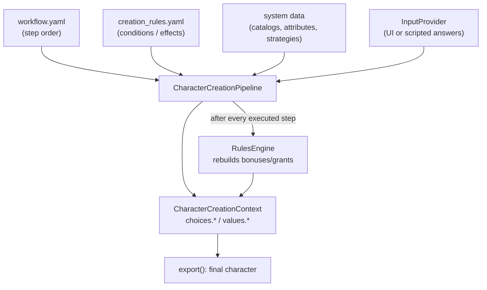

# Character Creation

**Companion4SoloPlayer** ships a generic, data-driven character creation
engine. Everything *game-system agnostic* lives in
`companion4soloplayer.core.creation`; everything *game-specific* (races,
classes, skills, spells, bonuses, strategies, step order) lives in each
plugin.

## Table of Contents

- [Overview](#overview)
- [State container](#state-container)
- [Steps](#steps)
- [Input providers](#input-providers)
- [Condition/Effect rules](#conditioneffect-rules)
- [Attribute generation strategies](#attribute-generation-strategies)
- [Pipeline](#pipeline)
- [Workflow configuration](#workflow-configuration)
- [Using the workflow from a plugin](#using-the-workflow-from-a-plugin)
- [Player creation dialog](#player-creation-dialog)

---

## Overview



The engine covers the functional requirements as follows:

| Requirement | Supported by |
| --- | --- |
| Race optional | `SelectionStep` with `optional: true`, or no step at all / no catalog |
| Class optional | same as race |
| Attributes: random **or** manual (all or part) **or** assigned by the game system | `AttributeGenerationStep` with `random` / `manual` / `mixed` / `auto` modes, each declared per block |
| A different generation method per block (dice or assigned values) | `AttributeGenerationStep` per-block `mode` / `strategy` (`random` + `classic_4d6` for the attributes, `auto` + `class_saves` for the saving throws) |
| Skills: free / inherited / none | `SkillSelectionStep` with `free` / `inherited` / `none` modes |
| Bonuses & maluses (race, class, attributes, skills...) | Condition/Effect rules evaluated after each step |
| Identity (name, background) | `IdentityStep` |
| Spells: filtered choice **or** automatic | `SpellSelectionStep` with `choice` (filter) / `auto` (rules grant them) / `none` |
| Step order varies per system | `workflow.yaml` declares the ordered step list |

---

## State container

`CharacterCreationContext` holds two namespaces addressed by dotted
paths:

- **`choices.*`** — the raw choices of the player
  (`choices.identity.name`, `choices.race`, `choices.class`,
  `choices.skills`...);
- **`values.*`** — the values computed by the steps
  (`values.attributes.strength`, `values.skills`, `values.spells`...).

On top of the base values, the rules engine records *operations*
(bonuses, maluses, grants). `context.effective(path)` folds the base
value and its operations; `context.export()` returns the final
character (raw choices + effective values).

Operations are cleared and rebuilt at **every** evaluation, so a bonus
is never double counted whatever the number of evaluations:

```python
from companion4soloplayer.core.creation import CharacterCreationContext

context = CharacterCreationContext()
context.set("values.attributes.constitution", 12)
# ... after an evaluation recording "+2 constitution" ...
assert context.effective("values.attributes.constitution") == 14
assert context.get("values.attributes.constitution") == 12  # base untouched
```

---

## Steps

Every step subclasses `CreationStep` and implements three methods:

| Method | Role |
| --- | --- |
| `is_applicable(context)` | tells whether the step must run (missing catalog, `inherited`/`auto`/`none` modes...) |
| `execute(context, inputs)` | asks the answers through the `InputProvider` and writes the state |
| `validate(context)` | returns the list of error messages (empty = valid) |
| `describe_inputs(context)` | declares the data the step will ask (answer key, widget kind, options) |

The generic steps shipped by the core are:

| Step | Purpose | Key parameters |
| --- | --- | --- |
| `IdentityStep` | name + background | `background_options`, `name_required`, `background_required` |
| `SelectionStep` | one choice (race, class...) | `target`, `catalog` **or** `options`, `optional` |
| `AttributeGenerationStep` | base attribute values | `mode` (`random`/`manual`/`mixed`/`auto`), `strategy`, `manual_attributes`, bounds — each accepted per block, see [Attribute generation strategies](#attribute-generation-strategies) |
| `SkillSelectionStep` | skill picks | `mode` (`free`/`inherited`/`none`), `skill_filter`, counts |
| `SpellSelectionStep` | spell picks | `mode` (`choice`/`auto`/`none`), `spell_filter`, counts |

A step that has nothing to do is **skipped**, which is how a game
system without races, spells or skills drops those requirements.

---

## Input providers

Steps never talk to a UI: they ask the session `InputProvider`.
`MappingInputProvider` replays pre-recorded answers (tests, scripts);
an interactive UI implements the same protocol with dialogs.

Answer keys are stable:

| Question | Key |
| --- | --- |
| Name | `identity.name` |
| Background | `identity.background` |
| Race / class / skills / spells | the `step_id` (`race`, `class`, `skills`, `spells`) |
| One attribute | `attributes.<name>` (e.g. `attributes.strength`) |

```python
from companion4soloplayer.core.creation import MappingInputProvider

inputs = MappingInputProvider({
    "identity.name": "Brom",
    "race": "Dwarf",
    "class": "Wizard",
    "skills": ["Diplomacy", "Medicine"],
    "spells": ["Rune Ward"],
})
```

---

## Condition/Effect rules

Rules express the bonuses and maluses of the game system. A rule is a
list of **conditions** (all must hold) gating a list of **effects**:

```yaml
# datas/creation_rules.yaml
rules:
  - id: dwarf_hardy
    description: Dwarves are hardy (+2 constitution).
    when:
      - target: choices.race
        operator: eq
        value: Dwarf
    effects:
      - target: values.attributes.constitution
        action: add
        value: 2
```

- **Condition** = *target + operator + value*. Operators: `eq`, `ne`,
  `gt`, `ge`, `lt`, `le`, `in`, `not_in`, `contains`, `not_contains`,
  `exists`, `not_exists`, `empty`, `not_empty`.
- **Effect** = *target + action + value*. Actions: `add`, `sub`, `mul`,
  `set`, `grant` (unique append), `remove`.

The `RulesEngine` is evaluated **after every executed step**, in
declaration order: a rule whose condition becomes true later (race
chosen, attributes rolled, skills picked...) is picked up at the next
evaluation, and later rules of the same pass see the effects of the
earlier ones (chaining).

---

## Attribute generation strategies

`AttributeGenerationStep` is the step rendering the attribute blocks of
the dialog; everything it does is declared in `workflow.yaml`:

```yaml
  - !pyclass
    path: companion4soloplayer.core.creation:AttributeGenerationStep
    params:
      step_id: attributes         # answer keys: <step_id>.<attribute>
      target: values.attributes   # state paths: <target>.<attribute>
      block: "*"                  # one step per attributes.yaml block
      mode: random                # who produces the value
      strategy: classic_4d6       # how a generated value is produced
      manual_attributes: []       # attributes asked in "mixed" mode
      min_value: 3                # inclusive lower bound
      max_value: 18               # inclusive upper bound
      label: Attributes           # step label (attributes.yaml wins)
```

(`step_id`, `target` and `label` are the generic step parameters;
`block` and its expansion are detailed in
[Workflow configuration](#workflow-configuration).)

### `mode` — who produces the value

`mode` accepts one of four values (default `random`):

| Value | The value comes from | Widget in the dialog | Bounds | Typical use |
| --- | --- | --- | --- | --- |
| `random` | the answer already recorded (a die rolled in the dialog, a scripted fixture...), else the **strategy** | `DICE`: label + die button | enforced | attributes rolled with dice |
| `manual` | the player, the answer being **required** | `NUMBER`: numeric text edit | enforced | point-buy, player-assigned arrays |
| `mixed` | the player for `manual_attributes`, the **strategy** for the other attributes | `NUMBER` for the manual ones, `DICE` for the others | enforced | roll the physical scores, choose the mental ones |
| `auto` | the **strategy** only: nothing is ever asked and no answer is ever read | `READONLY`: label + computed value | **not** enforced | values assigned by the game data (the saving throws of the chosen class) |

```yaml
# The player rolls every attribute of the block (demo `attributes` block)
mode: random
strategy: classic_4d6

# The player types every value; no strategy is ever needed
mode: manual
min_value: 3
max_value: 18

# Four scores are rolled, the player assigns the two listed ones
mode: mixed
strategy: classic_4d6
manual_attributes: [intelligence, charisma]

# Nothing is asked: the game system assigns the values (demo `save` block)
mode: auto
strategy: class_saves
```

Whatever the mode, the step writes **base** values under `target`
(`values.<block id>.<attribute>`); the race and class bonuses of
`creation_rules.yaml` are layered on top by the rules engine and read
back with `context.effective(...)`.

Worth knowing:

- in `random` and `mixed` modes a recorded answer **wins** over the
  strategy (this keeps the die rolled in the dialog and the final
  character in sync), while `auto` **never** reads an answer;
- `manual` (and the manual part of `mixed`) fails with
  `MissingInputError` when the player leaves a field empty;
- the bounds `min_value` / `max_value` are checked against the
  answers, the rolled values and the stored values — except in `auto`
  mode, whose values come from the game data (a magic saving throw of
  19 stays valid with `max_value: 18`);
- `manual_attributes` naming an attribute the system does not declare
  is reported by `validate()` as an error message.

### `strategy` — how a generated value is produced

`strategy` is read by `random` and `mixed` (for the attributes that are
not manual) and by `auto`; a `manual` block never needs one. Four
kinds of declarations are accepted, resolved in this order:

1. **a strategy instance** — any object exposing `roll(attribute,
   roller)`; in `workflow.yaml` such an object is obtained with a
   `!pyclass` reference resolving to an instance;
2. **a name** — looked up in `context.system["strategies"]`, the
   registry the plugin fills in `build_system()`; this is what
   `workflow.yaml` uses most of the time;
3. **a strategy class** — instantiated with no argument on the first
   roll, for example when a `!pyclass` reference points at the class
   itself;
4. otherwise the step fails with a `StepConfigurationError`
   (`no ... strategy configured`, `unknown strategy 'x' (available:
   ...)`, `x is not an attribute strategy`).

```yaml
# A registered name (the usual case)
strategy: classic_4d6

# A class: referenced with !pyclass, then instantiated with no
# argument -> RollStrategy(), i.e. a plain "4d6" sum (4 to 24)
strategy: !pyclass
  path: companion4soloplayer.core.creation.strategies:RollStrategy
```

Names registered by the demo plugin:

| Name | Implementation | What it generates |
| --- | --- | --- |
| `classic_4d6` | `FourSixKeepBestStrategy` | 4d6, drop the lowest die (3–18), the classic method of the demo system |
| `3d6` | `RollStrategy("3d6")` | a plain 3d6 (3–18) |
| `4d6_drop_lowest` | `RollStrategy("4d6", keep=3)` | 4d6 keeping the three highest dice |
| `class_saves` | `ClassSavesStrategy` | the saving throws of the chosen class, read from `classes.yaml`, **without any draw** |

The core ships two generic implementations a plugin can register under
any name:

- `RollStrategy(dice, keep=None, keep_best=True)` — rolls any dice
  notation and optionally keeps only the best (`keep=3`) or the worst
  (`keep_best=False`) dice: `RollStrategy("3d6")`,
  `RollStrategy("4d6", keep=3)`, `RollStrategy("4d6-2")`;
- `ConstantStrategy(value)` — always returns the same value (fixed
  arrays, tests).

A strategy producing **state dependent** values instead overrides
`roll_for(attribute, roller, context)`, which receives the creation
context: the default implementation delegates to `roll`, so a strategy
ignoring the state never has to declare it. The demo `class_saves`
strategy reads `choices.class` and `system["classes"]` that way and
returns the saving throws declared by `classes.yaml`:

```python
from companion4soloplayer.core.creation.strategies import (
    AttributeGenerationStrategy,
)

class ClassSavesStrategy(AttributeGenerationStrategy):
    def __init__(self, default=10):
        """Store the value used while no class is chosen."""
        self.default = default

    def roll(self, attribute, roller):
        """No creation state available: neutral fallback."""
        return self.default

    def roll_for(self, attribute, roller, context):
        """Read the class chosen so far and return its base save."""
        chosen = context.peek("choices.class")          # e.g. "Adventurer"
        for entry in context.system["classes"]:
            if entry["name"] == chosen:
                return int(entry["save"][attribute])    # e.g. 16 / 19
        return self.default
```

The step calls `roll_for(attribute, roller, context)` for every value
it generates, so a strategy may adapt to the state chosen so far
(class, race...) without changing the step.

---

## Pipeline

`CharacterCreationPipeline.run(context, inputs)` processes the steps in
order and returns a `CreationReport`:

- `report.ok` — no step failed;
- `report.completed` — every declared step was processed;
- `report.results` — per-step status (`executed` / `skipped` / `failed`)
  and error messages;
- `report.rules_fired` — identifiers of the rules that fired (unique).

Input and configuration errors fail the step instead of crashing the
run; the pipeline stops on the first failure by default
(`stop_on_error=False` continues).

---

## Workflow configuration

The **order of the steps is data**: each game system declares it in its
own `workflow.yaml`, as `!pyclass` references (the same security model
as `rules.yaml`: parsing never imports anything, absolute references go
through a module allow-list, `local:` references resolve inside the
plugin package):

```yaml
# plugins/demo_plugin/datas/workflow.yaml
steps:
  - !pyclass
    path: companion4soloplayer.core.creation:IdentityStep
    params:
      step_id: identity
  - !pyclass
    path: companion4soloplayer.core.creation:SelectionStep
    params:
      step_id: race
      target: choices.race
      catalog: races
      optional: true
  # ... attributes ...
  - !pyclass
    path: companion4soloplayer.core.creation:SkillSelectionStep
    params:
      step_id: skills
      mode: free
      skill_filter: !pyclass local:skill_available
  - !pyclass
    path: companion4soloplayer.core.creation:SpellSelectionStep
    params:
      step_id: spells
      mode: choice
      spell_filter: !pyclass local:spell_available
```

`build_workflow()` / `build_workflow_from_yaml()` turn the document into
a pipeline; parameters that are themselves `!pyclass` references (such
as the skill and spell filters) are resolved to the object they point
at.

An `AttributeGenerationStep` may declare `block: "*"`: it is then
expanded into **one step per attribute block** declared in
`system["attribute_blocks"]` (the level-1 entries of the plugin
`attributes.yaml`), in declaration order. Each generated step takes the
block id as its `step_id` and `block`, and stores its values under
`values.<block id>`; the other parameters come from the template. This
is how a game system declaring `attributes:` *and* `save:` in
`attributes.yaml` gets one dialog block per entry without listing them
in `workflow.yaml`. A workflow may also pin an explicit `block: <id>`
step (see below).

`mode`, `strategy`, `manual_attributes`, `min_value` and `max_value`
accept a plain value (shared by every block) **or** a mapping keyed by
block id, so one single entry gives each *type* of block its own
generation method:

```yaml
  - !pyclass
    path: companion4soloplayer.core.creation:AttributeGenerationStep
    params:
      block: "*"                    # one step per attributes.yaml block
      mode:
        attributes: random          # the dice are rolled...
        save: auto                  # ...while the saves are assigned
      strategy:
        attributes: classic_4d6
        save: class_saves
      min_value: 3                  # shared by every block
      max_value: 18                 # (not enforced in `auto` mode)
```

A per-block value is resolved **when the step is instantiated**, before
anything else is validated:

1. the entry whose key is the block bound to the step wins;
2. otherwise the `"*"` entry, which matches every block left
   undeclared, is used;
3. otherwise the step fails with a `StepConfigurationError`
   (`parameter 'strategy' declares no value for block 'save'
   (available: attributes)`), and a per-block value used by a step
   bound to no block (`block` empty) is rejected as well.

Since `min_value`, `max_value` and `manual_attributes` follow the same
rule, a block can carry its own bounds and its own manual list:

```yaml
      mode:
        attributes: mixed
        save: auto
      strategy:
        attributes: classic_4d6
        save: class_saves
      manual_attributes:            # only meaningful in `mixed` mode
        attributes: [intelligence, charisma]
        save: []                    # unused: this block is assigned
      # Bounds only constrain the answers and the rolls; a block
      # assigned by the game data (`auto`) is never bounds-checked.
      min_value:
        attributes: 3
        save: 0
      max_value:
        attributes: 18
        save: 30
      label: Attributes             # scalar value: shared by every block
```

Two shapes are therefore available:

- **one value for every block** (`mode: random`) — the simplest,
  when all the blocks of the step behave the same;
- **one value per block type** (`mode: {attributes: random, save:
  auto}`) — when the blocks of `attributes.yaml` are generated
  differently.

The demo workflow uses the second shape: the `attributes` block is
rolled with `classic_4d6` while the `save` block is *assigned* with
`class_saves`, so no dice are drawn during the creation. The base
saving throws then come from the `save` mapping of the chosen class
(`classes.yaml`, e.g. `16` / `19` for an Adventurer, `14` / `12` for a
Wizard) and are modulated by the race and class bonuses declared in
`creation_rules.yaml` (`+2` / `+2` for a Dwarf, `+2` magic for an Elf
or a Gnome...).

A workflow may also pin an explicit `block: <id>` step when it needs
one specific block at one specific position (with its own `mode` and
`strategy`, since a block bound that way no longer shares the template
of the other blocks):

```yaml
  - !pyclass
    path: companion4soloplayer.core.creation:AttributeGenerationStep
    params:
      step_id: save
      block: save
      target: values.save
      mode: auto
      strategy: class_saves
```

---

## Using the workflow from a plugin

The demo plugin exposes the assembled pipeline through the
`GamePlugin` contract:

```python
from companion4soloplayer.core.creation import MappingInputProvider
from companion4soloplayer.plugins.demo_plugin import Plugin

plugin = Plugin()
pipeline = plugin.create_character_creation()   # cached, stateless

context = pipeline.create_context()
report = pipeline.run(context, inputs)
if report.ok:
    character = context.export()
```

The plugin declares, under `plugins/demo_plugin/`:

- `datas/workflow.yaml` — step order and step parameters;
- `datas/creation_rules.yaml` — bonuses/maluses (race, class,
  attribute values, other skills);
- `datas/attributes.yaml` — the **attribute blocks**: every level-1
  entry (`attributes`, `save`...) declares one block rendered as its
  own group in the dialog; `title` is the heading of the block, the
  top-level order is the display order of the blocks and the list order
  is the display order of the fields; each entry declares the technical
  `id` (state path and answer key), the display `name` shown as the
  field label and an optional `description` shown as a tooltip;
- `datas/races.yaml`, `datas/classes.yaml`, `datas/skills.yaml`,
  `datas/spells.yaml` — the catalogs read through `system`; every race
  and class declares `can_cast_spells: true|false`, the flag gating
  the spells of the character, and every class declares the `save`
  mapping of its **base saving throws**, read by the `class_saves`
  strategy;
- `creation/strategies.py` — the named generation methods;
- `creation/filters.py` — the availability filters (`skill_available`
  opening the skill catalog, `spell_available` built on
  `can_cast_spells`);
- `creation/workflow.py` — the assembly (catalogs + rules + workflow).

---

## Player creation dialog

The **Manage > Player** menu (right above *Manage > Plugins*) opens the
dynamic creation dialog. The dialog belongs to the **application**
(`companion4soloplayer.ui.builder`), not to the plugins: any game
system exposing a creation pipeline through the `GamePlugin` contract
gets the same form, built from its `workflow.yaml` step order.

The entry is **greyed out while no plugin is loaded**: at least one
game plugin must be loaded through **Manage > Plugins** before a
character creation can start. Loading a plugin lights the entry up,
unloading every plugin greys it out again (the state is re-checked
every time the Manage menu opens).

```mermaid
flowchart TD
    W["workflow.yaml (plugin)"] --> P["CharacterCreationPipeline"]
    P -->|"describe_inputs() per step"| B["CharacterCreationDialogBuilder"]
    B --> D["CharacterCreationDialog<br/>sections of empty widgets"]
    D -->|Validate| R["pipeline.run(collected answers)"]
    R -->|ok| OK["accepted: report + context"]
    R -->|failure| KO["errors displayed, dialog stays open"]
```



- The **sections, the field count and their widget kinds** come from
  the steps declared by `workflow.yaml`, through
  `CreationStep.describe_inputs(context)`: one section (group box) per
  step describing data; steps asking nothing (`inherited` skills,
  `auto` spells...) are not rendered. The shape follows the answers
  while the form is filled: the skills list starts **empty** until a
  race or a class is chosen, the spells block appears only when the
  chosen race/class may cast spells (the `can_cast_spells` flag), and
  a system declaring no skills/spells never renders those blocks.
- The **attribute blocks** are fully driven by the plugin
  `datas/attributes.yaml`: every level-1 entry of the document renders
  its own group box (the demo system shows "Attributes" then "Saving
  Throws"), whose title is the declared `title`, each field label is
  the `name` of the matching entry ("Strength", "Dexterity"...) while
  the answer keys and state paths keep the technical keys
  (`attributes.strength` / `save.magic`, `values.attributes.strength` /
  `values.save.magic`), and a non-empty `description` shows up as a
  tooltip on the field. The widgets of a block follow its mode: dice
  buttons in `random` mode, number edits in `manual` mode, and
  **read-only values** in `auto` mode — the "Saving Throws" block
  displays the saving throws assigned for the chosen class and
  refreshes them whenever a choice changes, without ever asking the
  player to roll.
- Each data item renders a widget matching its `InputKind`:

  | Kind | Widget | Example |
  | --- | --- | --- |
  | `TEXT` | single-line text edit | character name |
  | `TEXTAREA` | multi-line text edit | character background |
  | `NUMBER` | single-line numeric edit | manually assigned attribute |
  | `DICE` | label + die button | randomly generated attribute |
  | `CHOICE` | single-selection list | race, class |
  | `CHOICES` | multiple-selection list | skills, spells |
  | `READONLY` | label + computed value | saving throw assigned from the class |

- The sections are laid out on a **two-column grid**: a section
  describing several fields (identity, each attribute block) takes a
  whole row,
  while two consecutive single-field sections share a row side by side
  (race on the left and class on the right, skills on the left and
  spells on the right). Inside an attribute block the fields are spread
  over **two equal columns**. The dialog is at least 860 x 640 pixels.
- Every editable widget starts **empty** (the read-only values the game
  system assigns are already displayed), and the choice lists (race,
  class, skills, spells) keep a fixed height showing **at least four
  rows**, so a catalog stays readable without scrolling inside the
  list.
- **Validate** collects the answers (empty widgets stay unanswered, so
  the steps keep enforcing their own required/optional rules), runs the
  pipeline and closes the dialog on success — `dialog.report` holds the
  `CreationReport`, `dialog.context` the filled state. On failure the
  step error messages are displayed and the dialog stays open.
- **Cancel** discards everything (`report` and `context` stay `None`).
- The sections and choice lists are **re-evaluated** whenever a
  selection or a die roll changes: the pipeline is replayed on a
  throwaway context with the answers collected so far
  (`stop_on_error=False`), so a filtered list — the spells restricted
  to the chosen class, for instance — always matches the state known so
  far, and a section appearing or disappearing with that state (the
  spells block) is shown, hidden or created on the fly.

```python
from companion4soloplayer.ui.builder import CharacterCreationDialog

dialog = CharacterCreationDialog(plugin.create_character_creation(), parent)
if dialog.exec():
    character = dialog.context.export()
```
